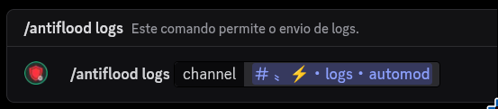

O comando **/antiflood** detecta flood em massa no seu servidor e age contra quem o pratica, de acordo com as preferências que você definir. Você escolhe a punição, define um canal para receber os relatórios e liga ou desliga o sistema.

<Info>
  **Permissão necessária:** Administrador.
</Info>

## Como usar

Digite **/antiflood** no chat e escolha uma das três opções abaixo.

<Tabs>
  <Tab title="Puníção">
    Alterna entre punir os usuários do antiflood com banimentos, expulsões ou castigos.

    | Campo | O que colocar |
    | --- | --- |
    | `Ação` | Escolha entre banir, expulsar ou castigar os usuários. |
    | `Tempo` | Quanto tempo a pessoa fica de castigo, por exemplo `10m`, `2h` ou `1d`. |

    <Frame caption="Opção Punição do comando /antiflood no Discord.">
      
    </Frame>
  </Tab>
  <Tab title="Canal">
    Define um canal para o The Reaper enviar os relatórios de quem foi punido por esse sistema.

    | Campo | O que colocar |
    | --- | --- |
    | `Canal` | O canal onde os relatórios serão enviados. |

    <Frame caption="Opção Canal do comando /antiflood no Discord.">
      
    </Frame>
  </Tab>
  <Tab title="Ativar">
    Alterna o sistema entre online e offline no seu servidor.

    <Frame caption="Opção Ativar do comando /antiflood no Discord.">
      
    </Frame>
  </Tab>
</Tabs>

<Tip>
  Para configurar bem, comece pela opção **Puníção**, depois defina o **Canal** dos relatórios e, por fim, use **Ativar**.
</Tip>

## Veja também

<Columns cols={2}>
  <Card title="Antispam" icon="shield" href="/commands/antispam">
    Detecte spam em massa e puna automaticamente.
  </Card>

  <Card title="Antifake" icon="user-shield" href="/commands/antifake">
    Remova contas falsas com base no tempo de conta.
  </Card>
</Columns>
