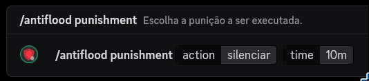
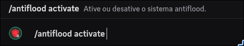

Para usá-lo, digite **/antiflood**.

O mesmo irá ter 3 grupos:

<Tabs>
  <Tab title="Punição">
    Use essa opção para alternar entre punir usuários no anti-fake com banimentos, expulsões ou castigos.

    - `Ação`: Alterne entre banir usuários, expulsar ou castigar através do antiflood.
    - `Tempo`: Decida quanto tempo a pessoa deve ficar de castigo (10m, 2h, 1d).

    
  </Tab>
  <Tab title="Canal">
    Mencione um canal para que o The Reaper envie os relatórios de quem foi punido com esse sistema.

    - `Canal`: Identifique um canal para seu relatório ser enviado.

    
  </Tab>
  <Tab title="Ativar">
    Use essa opção para alternar entre o sistema online ou offline no seu servidor.

    
  </Tab>
</Tabs>
