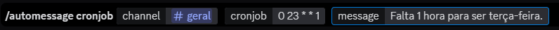

O comando **/automessage** envia mensagens automáticas no seu servidor com base em opções personalizadas, como um canal e um intervalo de tempo. Para casos mais avançados, você também pode agendar mensagens com um cronjob.

<Info>
  **Permissão necessária:** Administrador.
</Info>

## Como usar

Digite **/automessage** no chat e escolha uma das quatro opções abaixo.

<Tabs>
  <Tab title="Adicionar">
    Adiciona uma nova mensagem para ser enviada em um intervalo de tempo, em um canal específico.

    | Campo | O que colocar |
    | --- | --- |
    | `Canal` | O canal onde a mensagem automática será enviada. |
    | `Tempo` | O intervalo de tempo, por exemplo `10m` para 10 minutos. |
    | `Mensagem` | A mensagem que será enviada. |

    <Frame caption="Opção Adicionar do comando /automessage no Discord.">
      
    </Frame>
  </Tab>
  <Tab title="Remover">
    Remove uma mensagem automática, e o bot para de enviá-la.

    | Campo | O que colocar |
    | --- | --- |
    | `Mensagem` | A mensagem que deve ser removida. |

    <Frame caption="Opção Remover do comando /automessage no Discord.">
      
    </Frame>
  </Tab>
  <Tab title="Lista">
    Lista o que já foi definido e está ativo no servidor até o momento.

    <Frame caption="Opção Lista do comando /automessage no Discord.">
      
    </Frame>
  </Tab>
  <Tab title="Avançado: cronjob">
    Permite inserir cronjobs, que fazem agendamentos totalmente personalizados com base em tempo e expressões.

    | Campo | O que colocar |
    | --- | --- |
    | `Canal` | O canal onde a mensagem automática será enviada. |
    | `Cronjob` | O intervalo de tempo definido com um cronjob. |
    | `Mensagem` | A mensagem que será enviada. |

    <Note>
      O cronjob usa o horário America/Sao_Paulo.
    </Note>

    <Tip>
      Analise o seu cronjob no [CronTab Guru](https://crontab.guru) antes de usar.
    </Tip>

    <Frame caption="Opção de cronjob do comando /automessage no Discord.">
      
    </Frame>
  </Tab>
</Tabs>

## Veja também

<Columns cols={2}>
  <Card title="Autopublish" icon="bullhorn" href="/commands/autopublish">
    Publique automaticamente os canais de anúncio.
  </Card>

  <Card title="Welcome" icon="hand-wave" href="/commands/welcome">
    Configure uma mensagem de boas-vindas.
  </Card>
</Columns>
