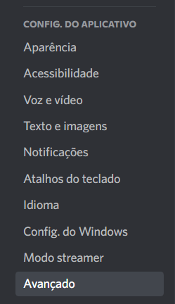
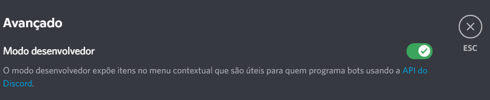
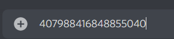

Ative o Modo Desenvolvedor e copie IDs de membros para utilizar nos comandos do The Reaper. Este guia reúne as informações disponíveis sobre o The Reaper e como aplicá-las no Discord.

<Steps>
  <Step title="Vá nas configurações de usuário" titleSize="h2">
  </Step>
  <Step title="Clique na aba 'Avançado' em 'Config. do aplicativo'" titleSize="h2">
    
  </Step>
  <Step title="Ative a opção 'Modo Desenvolvedor'" titleSize="h2">
    
  </Step>
  <Step title="Clique direito num usuário e clique em 'Copiar ID'" titleSize="h2">
    
  </Step>
  <Step title="Use Control+V" titleSize="h2">
    
  </Step>
</Steps>

## Precisa de ajuda?

Se encontrar uma opção diferente no Discord, confirme a versão do bot e procure o [servidor de suporte](https://discord.gg/TnvvwUStHK). Não compartilhe credenciais ou senhas em canais públicos.
