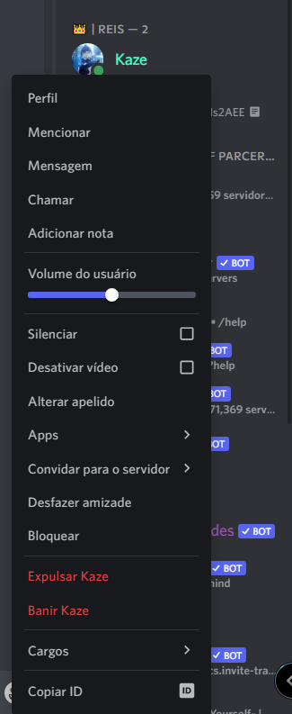

O ID de um usuário é um número único que identifica a conta dele no Discord. Alguns comandos do The Reaper, como [/ban](/commands/ban), [/massban](/commands/massban) e [/proof](/commands/proof), aceitam esse número. Para copiá-lo, você precisa ativar o Modo Desenvolvedor do Discord.

<Frame>
  
</Frame>

## Passo a passo

<Steps>
  <Step title="Vá nas configurações de usuário">
    Abra as configurações de usuário do Discord.
  </Step>
  <Step title="Abra a aba Avançado">
    Em **Config. do aplicativo**, clique na aba **Avançado**.

    <Frame>
      
    </Frame>
  </Step>
  <Step title="Ative o Modo Desenvolvedor">
    Ative a opção **Modo Desenvolvedor**.

    <Frame>
      
    </Frame>
  </Step>
  <Step title="Copie o ID do usuário">
    Clique com o botão direito em um usuário e clique em **Copiar ID**.

    <Frame>
      
    </Frame>
  </Step>
  <Step title="Cole o ID">
    Use **Control+V** para colar o ID no campo do comando.

    <Frame>
      
    </Frame>
  </Step>
</Steps>

## Veja também

<Columns cols={2}>
  <Card title="Ban" icon="gavel" href="/commands/ban">
    Bana um usuário pelo ID.
  </Card>

  <Card title="Proof" icon="file-circle-check" href="/commands/proof">
    Envie provas de um caso ao servidor oficial.
  </Card>
</Columns>
